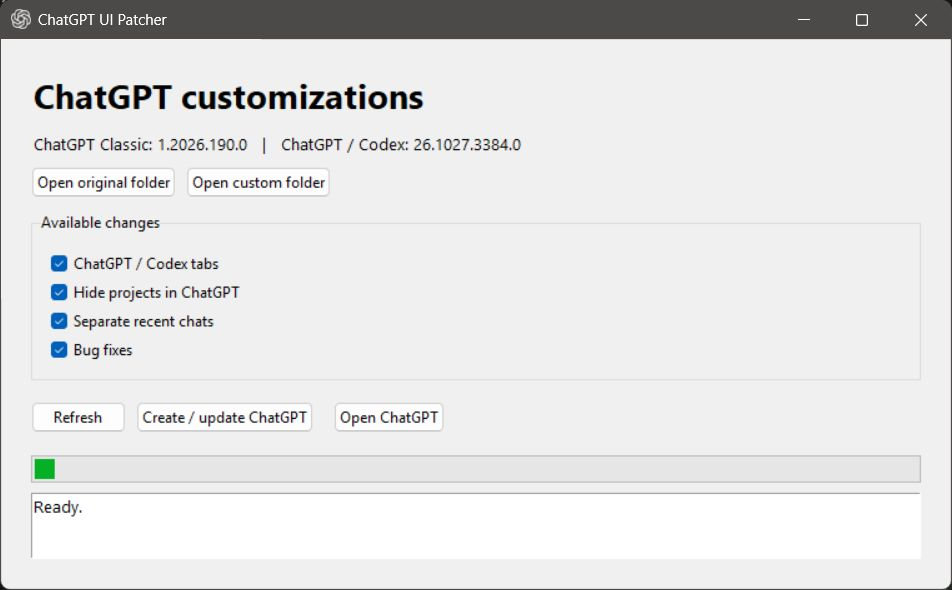

# ChatGPT UI Patcher

A small Windows tool for customizing the combined ChatGPT / Codex desktop app.
Choose your changes and create a separate local copy. The installed original stays untouched.

*Choose changes and inspect the original and custom app folders from the same window.*

## What can it change?

- **ChatGPT / Codex tabs** — switch products with tabs instead of the dropdown.
- **Hide projects in ChatGPT** — keep recent chats in ChatGPT and projects in Codex.
- **Separate recent chats** — show each product's conversations in its own recent list.
- **Bug fixes** — use your existing Codex history and return to each product's saved
  conversation when switching, or start a new one if there is no saved destination.

Each option can be selected independently.

**Temporary floating chat** is off by default.
It adds a floating tab bar on ChatGPT and Codex conversation/home screens. Hover over the
temporary-chat handle, then click **+** to create a regular ChatGPT side chat. Select a tab to show it
in the single floating panel; minimize without closing the chats. Tabs remain available during
navigation and product switches. Once a chat has a server ID, its tab metadata is saved locally
and restored after restart. Unsent drafts are session-only. Drag the panel by its title or the
bar by its temporary-chat handle; their positions are saved separately for each account. Focus either
handle and use arrow keys to move it (Shift for larger steps), or Home to reset its position.
Saved positions stay reachable when the window size changes.

Side chats are regular history chats tagged with the internal prefix `---temporary---`.
The customized bar, panel and history rows hide this prefix; history rows receive a dashed
title border and a native temporary-chat icon. The **disk** button keeps a chat by removing the prefix; the
**square** button opens it in the main area without changing its temporary status. An **×** on
each tab and in the panel header opens the native delete confirmation. Clicking the main area
minimizes the panel without closing its chats. One viewport-level bar is shared by sibling
history/main hosts as well as nested hosts. Failed deletions keep the tab. Other clients may display the raw prefix.
The core lifecycle was user-tested in both products, including deletion and restart restoration.
The selected tab has the native neutral selected background; header and bar buttons highlight on hover
or keyboard focus. The floating handle and **+** use the native outlined button variant so
they remain visible without hovering. Error recovery and account-switch paths have mocked component coverage.
See the [floating-chat test steps](docs/DEVELOPMENT.md#floating-chatgpt-chats).

## How to use it

1. Put `ChatGPT-UI-Patcher.exe` in a writable folder and run it. No installation or administrator rights needed.
2. Choose your changes and click **Create / update ChatGPT**.
3. Click **Open ChatGPT**, or use the `ChatGPT.lnk` shortcut created beside the tool.
4. Optionally click **Add to Start menu** to open your custom copy from Start as **ChatGPT C**.
   This adds a shortcut for your Windows user without administrator rights. Keep the patcher
   and its data folder in place so the shortcut keeps working. You can remove it from Start
   by right-clicking the entry, choosing **Open file location**, and deleting the shortcut.

The original app must already be installed. Use **Open original folder** to see
where files come from and **Open custom folder** to see the actual edited copy.
New copies live in `ChatGPT-UI-data/app` beside the tool; earlier copies retain their location.

After an official update, close the custom app and click **Create / update ChatGPT** again.
Your custom ChatGPT profile stays in place, so rebuilding does not reset your login.
The first launch or an expired session may still require sign-in.

## Privacy and safety

- The patcher works locally. It contains no telemetry, uploads, remote patch downloads,
  or application-level requests to a server.
- It reads the official installation, copies it, and edits the copy. It does not
  change the original app, its permissions, or its update settings.
- It checks the source signature and rebuilt files before replacing an existing custom copy.
  If a selected change cannot be applied safely, it reports that and keeps the current copy.
- There is no background patcher service. You run it when you want to create or update your copy.

The copied ChatGPT / Codex app still connects to OpenAI normally. Windows signature
validation and reputation checks may also use the network. With **Bug fixes** enabled,
both apps share your existing local Codex data: changes made in one can appear in the other.

This is an unofficial tool. The modified copy no longer has a valid OpenAI executable
signature, and the patcher EXE is unsigned. These safeguards reduce risk; they do not
constitute an independent security audit or a guarantee against every bug.
See [security and privacy](SECURITY.md) for the precise boundaries.

## Compatibility

Designed for Windows x64 and the combined ChatGPT / Codex Store app. The older standalone
ChatGPT Classic app has a different layout. There is no version allowlist: the tool tries
selected changes against the installed code and stops if it cannot identify the required structure.
Future redesigns may need a tool update.

Local integration covers app build **26.1103.32239** (Windows Store package **26.1103.4239.0**).
Component tests cover navigation, sidebar filtering and update recovery. See
[Validation](docs/VALIDATION.md) for the scope of the app checks.

## For developers

**Start with [AGENTS.md](AGENTS.md)** for the project map, rules and development workflow.
It is the shared entry point for new developers and coding agents.

[Build and test](docs/DEVELOPMENT.md) · [How it works](docs/ARCHITECTURE.md) ·
[Validation](docs/VALIDATION.md) · [Third-party notices](THIRD_PARTY_NOTICES.md)

This repository contains the patcher source and test fixtures, not the installed application,
modified application, account files or conversation history. Distribute the patcher separately;
users create their own copy locally. This project is not affiliated with OpenAI.
